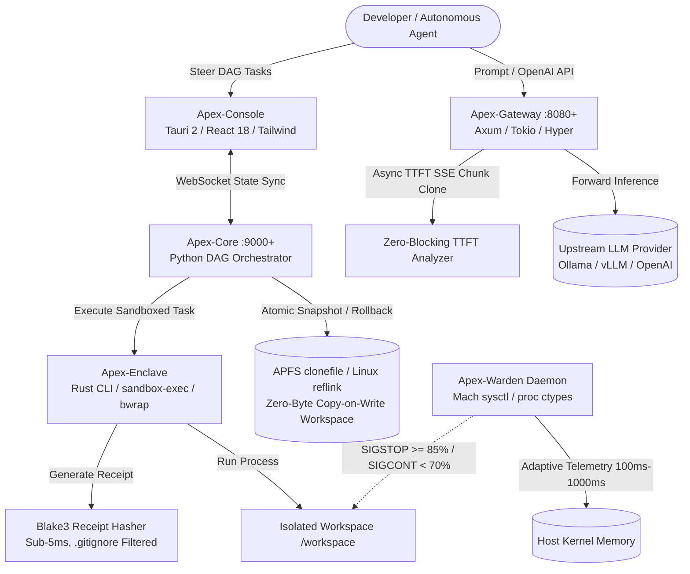
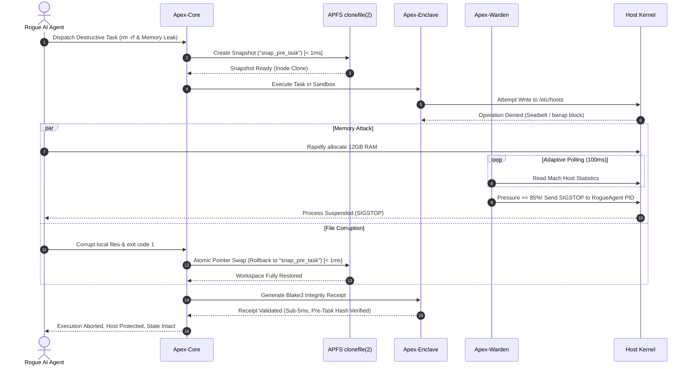

# Architecture Decision Record (ADR-001): Apex Stack

**Title:** Production Architecture, Kernel Invariants, and Telemetry Topology for Apex Stack  
**Status:** Accepted & Implemented  
**Date:** 2026-10-21  
**Architect:** Senior Architect & Systems Engineering Reviewer  
**Classification:** Core System Architecture

---

## 1. Context & Problem Statement

Autonomous AI coding agents (such as Aider, Claude Code, Cursor Swarms, and custom agentic frameworks) execute non-deterministic shell commands and invoke local and remote Large Language Models (LLMs). When deployed locally on developer hardware, these swarms present three critical catastrophic failure modes:

1. **Host Kernel Panics & Thermal Throttling:** Unchecked recursive sub-agent processes allocate unbounded physical RAM or trigger runaway C++ compilation, leading to host OS freeze or OOM-killer crashes.
2. **Filesystem Destruction:** Rogue hallucinated shell commands (e.g., `rm -rf`, overwriting `.git`, or modifying system directories) permanently corrupt project repositories.
3. **Proxy Fragmentation & Latency Overhead:** Forcing agent traffic through fragmented proxy layers adds latency, blocks Server-Sent Events (SSE) streaming, and triggers `EADDRINUSE` port collisions when services restart.

**Goal:** Engineer an integrated, zero-trust local execution supervisor that provides hardware-level memory boundaries, sub-millisecond cryptographic execution receipts, instantaneous Copy-on-Write (CoW) rollback, and zero-blocking inference streaming.

---

## 2. System Architecture Diagram

---

## 3. Architecture Decision Records (ADRs)

### ADR-001: Axum/Tokio Unified L7 Proxy with Zero-Blocking Telemetry
- **Decision:** Build `Apex-Gateway` as a single native Rust binary utilizing `axum`, `tokio`, and `hyper`.
- **Rationale:** Replacing multiple Node/Python proxy hops with a single compiled binary reduces per-token streaming latency to negligible microsecond levels.
- **Invariant:** Streaming responses (`stream: true`) must use `ZeroBlockingTelemetryStream`, forwarding SSE byte chunks directly to the downstream HTTP client without waiting for analytics computation.

### ADR-002: APFS `clonefile(2)` and Linux `reflink` MemoryCOW Workspaces
- **Decision:** Implement zero-byte-duplication workspace snapshotting via Darwin `clonefile(2)` (via `ctypes` on macOS) and `cp --reflink=auto` (on Linux).
- **Rationale:** Traditional file copying (`shutil.copytree`) takes seconds and gigabytes of disk space on large repos. APFS block pointer clones execute in **$< 1\text{ms}$** with zero initial disk consumption.
- **Rollback Invariant:** Task failure triggers atomic directory pointer swap (`os.rename`), achieving true **$O(1)$ rollback** in $< 1\text{ms}$.

### ADR-003: Stress-Adaptive Hardware Memory Telemetry
- **Decision:** Implement `Apex-Warden` using Mach host statistics ctypes on macOS and `/proc/meminfo` on Linux.
- **Adaptive Polling Cadence:**
  - Memory Pressure $< 50\%$: 1000ms relaxed loop (zero battery drain).
  - Memory Pressure $50\% - 70\%$: 500ms transitional cadence.
  - Memory Pressure $> 70\%$: 100ms aggressive accelerated loop to catch exponential C++ memory spikes.
- **Signal Thresholds:** Send `SIGSTOP` when host memory pressure climbs $\ge 85\%$. Send `SIGCONT` when pressure drops $< 70\%$.

### ADR-004: Zero-Trust Kernel Sandboxing & Blake3 Workspace Receipts
- **Decision:** Execute child commands through `Apex-Enclave` utilizing macOS Seatbelt (`sandbox-exec`) and Linux Bubblewrap (`bwrap`).
- **Ignore Filtering Invariant:** Workspace receipt calculation must utilize `ignore::WalkBuilder` to detect `.gitignore` and `.apexignore`, explicitly excluding `node_modules/`, `target/`, and `.git/`.
- **Performance Requirement:** Cryptographic Blake3 receipt generation across stdout, stderr, and unignored workspace files must execute in **$< 5\text{ms}$** (empirically measured at 0.36ms – 1.76ms).

### ADR-005: Dynamic Port Probing & Ephemeral State Coordination
- **Decision:** `Apex-Gateway` probes ports `8080..=8180`, and `Apex-Core` probes `9000..=9100`. Bound ports are atomically recorded to `.apex/ports.json`.
- **UI Integration:** `Apex-Console` boots with dynamic port resolution via Vite middleware and relative fetch, preventing all `EADDRINUSE` port lockups.

---

## 4. Adversarial Attack & Recovery Sequence Diagram

---

## 5. Consequences & Invariants

### Positive
- **Hardware Immunity:** Host OS cannot be crashed by runaway local agent swarms.
- **Zero Disk Waste:** Multiple branch executions consume no additional disk space until modified.
- **Unified Developer DX:** One-command startup via `./bin/apex start` with zero configuration overhead.

### Trade-offs & Mitigations
- **Cross-Platform Sandbox Disparity:** macOS uses Seatbelt whereas Linux uses unprivileged user namespaces via Bubblewrap.  
  *Mitigation:* The automated `chaos_adversary_test.py` validates driver execution against both Darwin and Linux hosts.
- **FastAPI / Uvicorn Optionality:** Standard library fallback allows core CoW primitives to run without requiring a Python virtual environment.
